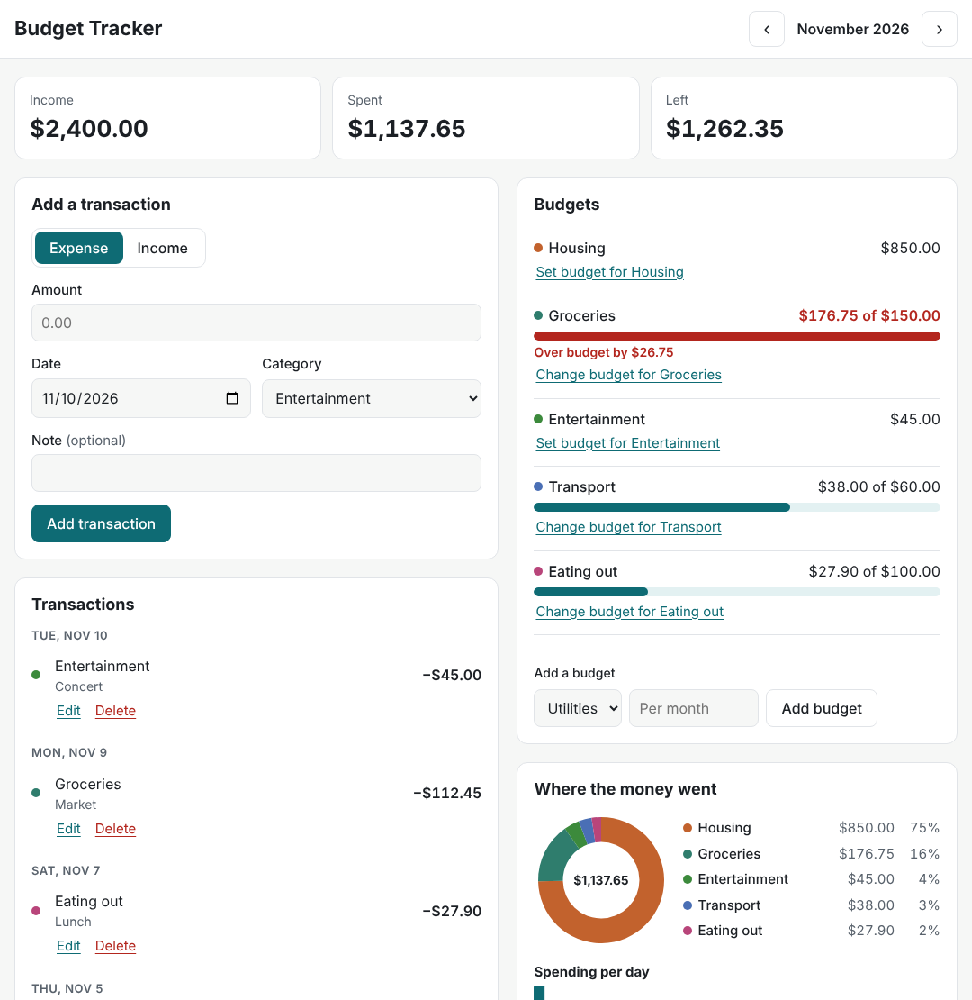

# Budget Tracker

[](https://github.com/daen8584-spec/budget-tracker/actions/workflows/ci.yml)

A personal budget app that runs in the browser. Track income and spending, set a monthly budget per category, and see where the money went. Everything stays on your device, and it works offline.

**Try it:** [daen8584-spec.github.io/budget-tracker](https://daen8584-spec.github.io/budget-tracker/)



## Features

- Income and expenses by category, grouped by day, with edit and delete (with undo)
- Monthly budgets per category, with bars that turn amber at 80% and red when over
- Charts of spending by category and by day
- Amounts typed either way: `1,234.56` or `1.234,56`
- 14 currencies
- CSV export and import, with clear messages for rows that can't be read
- Works offline and installs on a phone like an app
- Light and dark mode, phone and desktop layouts
- Usable with a keyboard and a screen reader

## Privacy

There is no server and no account. Data is kept in the browser's IndexedDB on your device. Export a CSV file to back it up or move it to another device.

## Running it

Requires Node.js 22 or later.

```bash
npm install
npm run dev
```

Then open http://localhost:5173.

| Command | What it does |
| --- | --- |
| `npm run dev` | Development server |
| `npm run build` | Production build in `dist/` |
| `npm test` | Unit and component tests (Vitest) |
| `npm run test:e2e` | Browser tests against the production build (Playwright) |
| `npm run lint` | Lint (oxlint) |
| `npm run typecheck` | Type check (TypeScript, strict) |

## How it's built

React 19 and TypeScript, built with Vite. No UI or chart libraries: the charts are plain SVG.

- **Money is stored as whole cents**, so totals never pick up rounding errors.
- **Storage** is IndexedDB. Changes are saved before they are shown, so the screen never shows something a reload would lose, and an import is saved completely or not at all.
- **Offline support** comes from a service worker that a small Vite plugin writes at build time, with the exact list of files in that build. Each new version replaces the old cache.
- **Accessibility:** form errors are linked to their fields, charts come with the same numbers in a table, and buttons say what they act on ("Delete Groceries $12.50").
- **CSV export** protects against spreadsheet formula injection: a note that starts with `=` stays text when the file is opened in Excel.

## Tests

- 52 unit and component tests: money parsing in both notations, budget math, month boundaries and leap years, CSV quoting, storage across reloads, and the add form during a slow save.
- 22 browser tests on a desktop and a phone screen, run against the production build: everyday use, CSV round trips, reloading with no connection, keyboard-only use, and an [axe](https://github.com/dequelabs/axe-core) accessibility scan in both themes.

The tests found three bugs before release. Undoing a delete saved the entry but didn't show it until a reload. Offline, the app's script couldn't be found in the cache when the server sent a `Vary: Origin` header, because the browser's request had an `Origin` header the cached copy didn't. And on the slower CI machines, an amount typed while the previous entry was still saving got wiped when that save finished. All three are fixed and covered by tests.

## License

MIT
